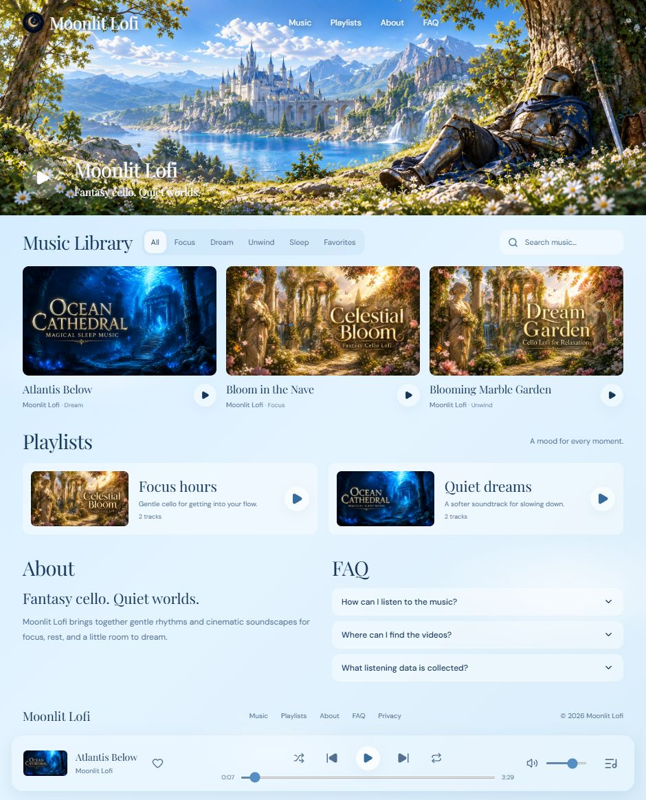

# Moonlit Lofi

A dreamy music channel website with a sky-blue glass interface, music playback, playlists, favorites, a queue and sleep timer.

Playback supports Repeat off, Repeat all, and Repeat 1 on desktop and mobile. Repeat off stops at the end of the queue; Repeat all restarts the queue; Repeat 1 loops the current track. The playlist section shows four collections initially, with See more / Show less for larger collections.

**[Listen live — Moonlit Lofi](https://moonlit-lofi-website.vercel.app/)**

## Latest website design

The complete public website, captured from the live Vercel deployment.

[](https://moonlit-lofi-website.vercel.app/)

## Hosting architecture

- **Vercel** serves the public website, protected creator Studio, authentication, and music APIs.
- **Neon Postgres** stores tracks, playlists, channel settings, memberships, and listening insights.
- **Private Vercel Blob** stores uploaded audio/artwork. Every media read checks public/member/creator access before streaming; audio seeking preserves HTTP byte ranges.
- `/studio` requires the single owner account. Public sign-up is disabled. Large uploads go directly from the authenticated browser to private Blob storage.
- The original Sites source remains in `backend/sites/` for recovery and is excluded from Vercel builds. Native production mode does not call it.

## Local development

```sh
npm ci
cp .env.example .env.local
```

Configure `MOONLIT_BACKEND=native`, `DATABASE_URL`, `BLOB_READ_WRITE_TOKEN`, `BETTER_AUTH_SECRET`, and `BETTER_AUTH_URL`. Use an isolated database and a localhost auth URL for development. Never expose these through `NEXT_PUBLIC_` variables. Schema/import and owner setup instructions are in [the migration guide](docs/vercel-migration.md).

```sh
node scripts/migrate-native.mjs
npm run dev
```

## Access boundary

Each creator API verifies a Better Auth session against the single owner record. Browser-supplied identity headers do not grant access. Member codes are checked against active, unexpired hashes in the database. Public playlists and audio omit draft/unpublished/member-only tracks unless the request has access. Listening-country data uses Vercel's platform country header; raw IP addresses are not stored in the listening database.

## Creator features

Open `/studio` to sign in with the creator account on Vercel. Studio supports audio uploads, replacing published cover artwork, editing metadata and YouTube links, creating/editing playlists, configuring music-platform links, and viewing country/time insights.

- Save tracks as drafts, unpublish without deleting the audio, and restore them later. Drafts and unpublished tracks are excluded from the public catalog and playlist playback. Previously shared static seed files are not DRM-protected.
- Reuse existing artwork during upload and move playlist tracks up or down to set playback order. Hidden tracks retain their place in the saved playlist and return there when restored.
- Filter listening insights by track, country, and an inclusive UTC date range of up to 366 days. Hour-of-day charts use the selected display time zone. Minutes are listening time, not unique listeners or play counts.
- The public player remembers the last track, position, playlist, volume, shuffle and repeat settings in this browser. Reloading restores the position while keeping playback paused.
- Media Session handlers provide play/pause, previous/next, and seeking on supported system media controls. Lock-screen availability varies by device and browser.
- Artwork uses responsive WebP derivatives and Next.js image optimization on Vercel. The initial page shows a loading placeholder instead of outdated sample covers, fetches the catalog without caching, and refreshes it when returning to the tab. Future artwork uploads are resized to at most 1280 pixels in the browser while keeping the creator's local originals intact.

## Validation

### Member early access

Studio → Members creates a personal 256-bit access code for an approved listener (1–366 days). It is displayed once; only its SHA-256 hash is stored. Revoke or restore access from the same tab. Listeners enter the code under Members; Vercel stores it in a Secure, HttpOnly, SameSite cookie for up to 30 days. This is invitation-code membership, not verified email identity or paid billing. Anyone holding a code can use it; share it privately.

For a newly uploaded track, choose Published + Members — early access. An optional public release date uses the creator's browser time zone and is stored as UTC. Without a date, the track stays members-only. Catalog, playlists, and uploaded audio enforce access on the server. Public release becomes available on the next refresh; the player refreshes every minute and on tab focus. Previously public/downloaded files cannot be recalled; upload new audio for unreleased member tracks. Static sample audio cannot be member-gated. Private artwork bypasses the shared image optimizer.

Tests cover anonymous denial, hash-only code storage, expiry/revocation, draft exclusion, media access, scheduled release, cookie flags, and gateway isolation.

Run `npm test` with Node.js 24. Tests cover native PostgreSQL routes and real password/session authentication through isolated PGlite databases, plus the retained legacy gateway/SQLite behavior, playlist ordering, analytics dates, membership, artwork, and resume state. Tests do not modify production data.

## Deployment

Native production uses `MOONLIT_BACKEND=native`. See [migration and recovery instructions](docs/vercel-migration.md) for environment, import, creator setup, and rollback details.

Import this repository into Vercel as **Next.js**, keep the root directory at the repository root, and configure the native server-only variables described above. The included `vercel.json` sets the build commands. Git commits can then trigger deployments automatically.

## Assets

The music, logo and fantasy artwork belong to the Moonlit Lofi channel project. Secrets, local databases, uploaded runtime files, and private Git history are not part of this repository.
